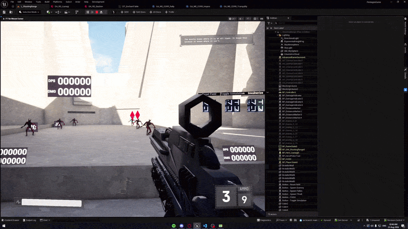

<include from="see-also.topic" element-id="see-also">
    <var name="topic" value="Angel.md"/>
    <var name="topic-summary" value="This project served as a partial base for FATE."/>
</include>

# FATE

<primary-label ref="fate"></primary-label>
<secondary-label ref="futuregames"></secondary-label>
<secondary-label ref="group"></secondary-label>
<secondary-label ref="unreal"></secondary-label>
<secondary-label ref="multiplayer"></secondary-label>
<secondary-label ref="angelscript"></secondary-label>
<secondary-label ref="c++"></secondary-label>

<tldr>
    

        FATE is a <b>love-letter to Destiny (2)</b>, and an attempt at creating a <b>new genre ("Raid-like")</b>.
         Our combined efforts across <b>7 weeks</b> brought us a game we were overjoyed to see others play.
    

<quote>

Additionally, FATE's technical implementation is my most ambitious project, stretching <b>15,000+ lines of code</b> across <b><tooltip term="Angelscript" id="angelscript">Angelscript</tooltip> and C++</b>, with over <b>300</b> hours spent coding.

</quote>
</tldr>

<chapter title="Design direction" id="design-direction">
    

        FATE is a Destiny-inspired <b><tooltip term="Rogue-lite" id="rogue-lite">rogue-lite</tooltip> FPS puzzle
        game</b> about collaborating with up to two friends in encounter-based levels. Players must solve puzzle
        mechanics while repeatedly-spawning enemies create <b>constant pressure</b>. The goal was to capture the
        communication, coordination, and combat tension of a traditional Destiny raid in a smaller experience.
    

<procedure>
    
The design was guided by three pillars:

    <list>
        <li>
            <b>Collaborative:</b> Each encounter requires at least two players to complete without debug tools.
            This was an intentional constraint: players should have to <b>communicate and solve problems
            together</b> while enemy combatants threaten to overwhelm them.
        </li>
        <li>
            <b>Great gunplay:</b> A Bungie-inspired game needed responsive, meaty, and distinctive weapons.
            Bullet magnetism makes shots feel responsive, hit VFX and SFX give them impact, and three heroes with
            different guns and playstyles make the combat uniquely interesting and rewarding.
        </li>
        <li>
            <b>Environmental:</b> We had a limited art budget, so the level itself had to carry much of the
            storytelling and guidance. The environment needed to <b>lead players through the level</b> and
            communicate puzzle solutions clearly without making them obvious.
        </li>
    </list>
</procedure>
</chapter>

<tabs>
<tab title="GunComponent" id="implementation">
    <chapter title="GunComponent" id="gun-component">
    <tldr>
        The up-to-date files are hosted on a private repository, so snippets are dated to August 3rd 2026.
    </tldr>

        

            I designed and implemented the GunComponent, which is a pillar of the project: <b>every shot a player
            fires goes through it</b>. FATE's weapons are <b><tooltip term="Hitscan" id="hitscan">hitscan</tooltip></b>,
            so there are no projectiles to simulate. Instead, the component answers a handful of questions every
            time the trigger is pulled:
        

        <list>
            <li>
                <b>May this shot fire?</b> It checks the fire rate, the fire mode (semi, burst or auto), ammo,
                and the shot cooldown.
            </li>
            <li>
                <b>Where does the bullet go?</b> It calculates the final direction of the shot. It starts from
                where the player is aiming, widens or tightens the spread depending on movement and how long
                they have been firing, and then nudges near-misses toward a nearby target with bullet-magnetism.
            </li>
            <li>
                <b>What did it hit?</b> It traces that final direction, hands the hit to the damage pipeline,
                and plays tracer and impact effects for every player.
            </li>
            <li>
                <b>How should it feel?</b> It kicks the player's view with recoil and eases it back again, and
                handles aim-down-sights zoom.
            </li>
        </list>
        

            That is a lot for a single component, and it is a direct result of our time constraints. We had a great
            deal to develop, which left little to no time for abstraction and refactoring, so new behaviour mostly
            went into the component that already owned shooting. <b>It's something I learned from:</b> on bigger
            projects I now take into account that I may need to refactor and design my implementation around that
            from the start.
        

        

            Values like spread, recoil, aim-assist, and fire rate are data rather than code, so each gun and hero
            can be tuned on its own. The rest of this section covers the parts that shape <b>how shooting feels
            the most</b>, and the thinking behind each of them.
        

<procedure>
        <deflist type="full" collapsible="true" default-state="collapsed">
        <def title="Following one shot" id="one-shot">
            

                When the player fires, <code>Fire()</code> builds the bullet's final direction in four steps, each
                one building on the last:
            

            <list type="decimal">
                <li>The exact point in space the player was aiming at.</li>
                <li>A deviation from the target point (1.) -- the 'spread point' (or bloom.)</li>
                <li>
                    A nearby target, if applicable, used to calculate the bullet-magnetism correction.
                </li>
                <li>The final calculated point in space the bullet will hit.</li>
            </list>
&nbsp;
<code-block lang="actionscript" collapsible="true" default-state="expanded" collapsed-title="GunComponent.as - Fire() function" emphasize-lines="8,12,31-35" src="../resources/GunComponent.as" include-lines="427-469"/>

 <!-- formatting fix -->
<warning>Clarification: Although the variables are named e.g. 'Spread<b>Point</b>', most of them are actually unit vectors, and do not represent a world location. Some time during development the variables' purpose changed, but their names unfortunately did not.</warning>
     </def>
     <def title="Bullet magnetism" id="bullet-magnetism">
         

             Bullet magnetism bends a shot that would have narrowly missed toward a target the player was aiming
             near, so near-misses are more likely to hit. I added it because it is one of the foundational parts
             of Bungie shooters, and a big reason shooting in Halo, Destiny and Marathon feels so snappy and
             responsive. FATE is a Destiny-inspired game, so it needed to feel that way.
         

         

             The tension I designed around is that <b>accuracy should still matter, but a near-miss should not feel
             needlessly brittle</b>. Small aiming errors are common during movement, recoil, and hectic encounters,
             so I wanted the system to preserve what the player was trying to do while still rewarding them for
             aiming near the target. The player still has to aim in the right direction; the system simply makes
             the edge of that accuracy more forgiving.
         

         

             Studying how Destiny's (and Marathon's) shooting is designed helped enormously. Two videos were instrumental in learning how it works:
              • <a href="https://www.youtube.com/watch?v=qrJv7mj7Ab4">Accuracy, Aim Assist &amp; Range Explained In-Depth</a> by Drewsky
              • <a href="https://www.youtube.com/watch?v=LTVi3owxttc">How Aim Assist & Accuracy REALLY Work in Marathon</a> by CoolGuy
         

         

             To implement it, each shot sweeps a capsule trace along the line the player is aiming. The capsule's
             radius comes from the weapon's aim-assist angle (<code>tan(angle) × distance</code>), so the
             forgiveness is the same angular amount whether the target is close or far away. This decision was
             because our levels are large and open, and punishing shooting at targets at a distance didn't feel
             great. The same principle applies to why we don't use any damage-or-bullet falloff.

If the capsule finds a target, the spread direction is pulled toward the point it hit on that target, by at most that many degrees. Because the pull is capped by an angle instead of snapping to the target, aiming still matters.

There is one exception: if the shot's spread trace already lands on a precision hit (a head), magnetism is skipped. It can never pull a shot away from a headshot the player already earned – a bug we discovered during testing.

&nbsp;
<code-block lang="c#" collapsible="true" default-state="collapsed" collapsed-title="GunComponent.as - bullet magnetism (capsule sweep and pull)" emphasize-lines="3,19,27-39,60,66-67" src="../resources/GunComponent.as" include-lines="502-510,512-549,572-604"/>

<deflist type="full" collapsible="true" default-state="collapsed">
<def title="Click to view a visualization in-engine" id="bullet-magnetism-visualization">
    
               

                   Although I'm clearly aiming at the target closest to the wall, the bullet is pulled toward the
                   closer target.
                    
                   This is because the bullet-magnetism capsule trace detected the closer target, and pulled the
                   bullet toward it.
               

               
               

                   The dark blue line/capsule trace represents the exact point you were aiming at,
                    
                   and the light blue line represents the path the final calculated bullet took.
               

               
               

                   Although it looks like the furthest target was hit by the trace, the bullet stopped when it hit
                   the closer target.
               

               

                   While it wasn't how I learned how it works, the video <a href="https://www.youtube.com/watch?v=yv3lRNAxA0o">"How Halo's Aim Assist ACTUALLY works"</a>
                   showcases how it works perfectly:
               

               <video src="https://www.youtube.com/watch?v=yv3lRNAxA0o" muted="true"/>
           </def>
           </deflist>
       </def>
       <def title="Movement spread" id="movement-spread">
           

               Spread is the cone a bullet can land in, and <code>GetSpread()</code> decides how wide that cone is
               for every shot. It builds up across the magazine along a per-weapon curve, gets a flat penalty on top
               while the player is running or airborne, and starts out tighter when aiming down sights. The first
               shots after pausing are 'protected' and get an even tighter cone, which <b>rewards pausing between
               engagements</b>.
           

           

               Movement-spread was originally much more punishing. It came over from <a href="Angel.md">the Angel project</a>, which is a
               tactical FPS, where you must stand completely still for the best accuracy. FATE is an action FPS
               like Destiny, so I adjusted it multiple times over the course of the project. In a tactical FPS,
               accuracy is more binary: standing still is the requirement for a precise shot, while moving should
               apply a clear penalty. In an action FPS, bloom should feel like a natural reaction to firing, not a
               yes-or-no condition for whether a gun is accurate.
           

           

               That is why <code>GetSpread()</code> increments spread across a magazine instead of simply setting it
               to a movement penalty. The early version used a binary penalty, and the result was that moving made
               guns feel totally inaccurate even on their first bullet. The current approach lets a moving player
               remain reasonably accurate at the start of an engagement, while <b>rapid fire naturally widens the
               bloom</b> over the course of the magazine.
           

           

               The movement penalty is tuned per gun and hero to fit their player fantasy. Bastion has a bigger
               movement-spread penalty than, say, Hawkmoon, because the fantasy is a less mobile, spray-and-pray
               frontliner. Bastion also gains bonus damage for remaining still, which further emphasizes that you
               should plant your feet rather than move around while shooting. <b>The penalty isn't so egregious that
               you can't be accurate while moving</b>, but the spread does noticeably increase as you fire Bastion's
               large 100-round magazine.
           

           

               All of those knobs are data on the weapon definition: the spread curve, first-shot and maximum
               spread (separately for hip-fire and aiming down sights), the number of bullets it takes to reach the
               maximum, and the running and airborne penalties. A shot is protected when the player has been still
               for half a second and has not fired for three quarters of a second.
           

&nbsp;
<code-block lang="c#" collapsible="true" default-state="collapsed" collapsed-title="GunComponent.as - GetSpread() and IsBulletProtected()" emphasize-lines="8,23-26,29,53-55" src="../resources/GunComponent.as" include-lines="126-134,336-385"/>

</def>
        <def title="Recoil recovery" id="recoil-recovery">
            

                Every shot kicks the player's view up and sideways, and the view then eases back to where it started
                on its own.
            

            

                The recovery is there to make consistent firing feel less taxing. With the lerped recovery, you
                don't need to manually account for the recoil of each shot and readjust your aim back onto the
                target after every bullet. That is especially effective for guns with stronger recoil, like
                Hawkmoon and Izanagi. Constantly readjusting after every bullet proved exhausting for players who
                weren't very familiar with FPS shooting, again especially on high-recoil weapons. Once I added the
                recovery, <b>the gunplay felt much better overall</b>.
            

            

                It took a lot of effort on the implementation side. Recoil is applied as controller input rather
                than as a camera animation, so the player's view is a mix of recoil and their own aim, and the
                recovery has to undo only the recoil. The component therefore keeps a running tally of exactly how
                much recoil it has injected (the 'recovery debt') and feeds the opposite input back, lerped over a
                settle time set on each weapon's recoil data. Since recovery is just more input, normal mouse or
                controller movement keeps working while the view settles. Recoil also only runs on the owning
                client, because it moves that player's own view.
            

&nbsp;
<code-block lang="c#" collapsible="true" default-state="collapsed" collapsed-title="GunComponent.as - UpdateRecoil() and ApplyControlRecoil()" emphasize-lines="9,26,38-42,66,72-75" src="../resources/GunComponent.as" include-lines="817-894"/>

</def>
        <def title="Cooldown handling" id="cooldown-handling">
            

                The shot cooldown is handled inside the GunComponent, as opposed to in the gameplay ability through a
                cooldown <tooltip term="GameplayEffect" id="gameplay-effect-cooldown">GameplayEffect</tooltip> committed with CommitAbility/CommitCooldown, which is the standard <tooltip term="Gameplay Ability System (GAS)" id="gas-cooldown">GAS</tooltip>
                approach. <code>Shoot()</code> turns the weapon's fire rate into a cooldown and refuses any shot
                that comes too early.
            

            

                This was a deliberate trade-off, for two reasons:
            

            <list>
                <li>
                    The original shooting logic was developed for <a href="Angel.md">the Angel project</a>, which did not use GAS for shooting at
                    the time. When I ported it to FATE, I kept the internal shoot cooldown as part of the gun
                    component. It was both a challenge and a boon. The difficulty was that it wasn't connected to
                    GAS: whether we could shoot did not depend on whether the ability could be committed, which led
                    to a lot of debugging issues, until I found the cause and reworked it slightly.
                </li>
                <li>
                    Handling it manually gave me more control over when to allow, disallow or override shooting
                    during active development. I was unfamiliar with the intricacies of GAS, and it was more
                    efficient to lean on what I knew than to rework the system mid-project.
                </li>
            </list>
            

                Once the project was 'completed' (we reached our deadline), I reviewed the implementation. <b>My
                future projects have opted to use the native GAS checks</b> for cost and cooldown, together with
                extensive use of gameplay tags.
            

            

                The component still plays nicely with GAS where it needs to. <code>bIgnoreInternalCooldown</code>
                lets an ability bypass the internal cooldown (and ammo check) when it wants to use a custom
                GameplayEffect cooldown instead.
            

&nbsp;
<code-block lang="c#" collapsible="true" default-state="collapsed" collapsed-title="GunComponent.as - Shoot() function" emphasize-lines="15,21-31,35-41" src="../resources/GunComponent.as" include-lines="973-1015"/>

</def>
        <def title="Supporting work" id="supporting-work">
            

                Many changes like these that gave us extended functionality in script or blueprint were often made
                on the C++ side.
                 
                I also extended our editor through C++ and <tooltip term="Angelscript" id="angelscript-editor">Angelscript</tooltip> to improve our workflow (examples include
                linking directly to documentation in the toolbar.)
            

            

                Alongside the implementation of GAS -- which comes with client-predicted replication -- we also had
                a lot of manual replication to handle.
                 
                My primary role on the replication side of things was replicating game state to the UI, such as
                healthbars, nametags, and boss-bars.
                 
                However, as the most experienced with replication, I still remained the primary source of
                information and assistance on the topic.
            

        </def>
        <def title="What I would change" id="gun-reflection">
            

                If I rebuilt the GunComponent today, I would lean more heavily on native GAS systems.
                 I am much more familiar with GAS now, and cooldowns in particular could be handled more gracefully through
                proper GameplayEffects and gameplay tags instead of remaining partly inside the component.
            

            

                I would also split the component's responsibilities. Recoil and spread could each become their own
                components, while the trace logic could be simplified into a reusable component.
                 I did the latter for , since we only needed to trace with magnetism – no recoil or spread.
            

        </def>
        </deflist>
       
 A couple of other things in the GunComponent also contribute to the shooting feel:

       <list>
           <li>Aim-down-sights zoom and alternate weapon-mode support, which smoothly interpolates the camera's field of view.</li>
           <li>Replicated tracer and impact effects, with hits on characters running the target's own hit-reaction cue (precision hits have their own).</li>
       </list>
</procedure>
</chapter>
</tab>

<tab title="HealthAttributes" id="health-attributes">
   <chapter title="HealthAttributes" id="healthattributes-chapter">
<tldr>
    The up-to-date files are hosted on a private repository, so snippets are dated to August 3rd 2026.
</tldr>
<deflist type="full" collapsible="true" default-state="collapsed">
   <def title="Damage handling" id="health-damage">
       

           The HealthAttributes script is the backbone of taking and dealing damage. Whenever a damage or healing
           <tooltip term="GameplayEffect" id="gameplay-effect">GameplayEffect</tooltip> lands, it works out what
           actually happened (how much damage, whether it was a precision
           hit, whether it was a kill) and fires the matching enchantment triggers.
       

       

           The design goal was to <b>centralize damage handling</b> for both health and shields. Shield handling was
           inherited from <a href="Angel.md">Angel</a>, although shields were never used in FATE. Keeping both
           paths in one system made it possible for enemies and shootable interactable objects to respond to hits
           consistently.
       

       

           For example, the symbol puzzle lets players shoot symbols to tether them together. Custom hit-reaction
           actors expose events for reacting to damage and dying, so puzzle logic can use the same damage system as
           combat. Because the interactions are handled through <tooltip term="Gameplay Ability System (GAS)" id="gas-symbol">GAS</tooltip>, <b>multiple players shooting a symbol are
           resolved through the same shared pipeline</b>.
       

       

           We extended the GameplayEffect context with fields such as <code>IsPrecisionHit</code>, so both script
           and Blueprint could inspect the result of a hit without reconstructing it elsewhere. That context also
           carries the trigger tags used by the enchantment system.
       

&nbsp;
<code-block lang="c#" collapsible="true" default-state="collapsed" collapsed-title="HealthAttributes.as - PostGameplayEffectExecute()" emphasize-lines="31,37-47,66-78,83-88,125-139,191,207-209" src="../resources/HealthAttributes.as" include-lines="150-380"/>
   </def>
   <def title="Designer-friendly enchantments" id="health-enchantments">
       

           Damage also needed to invoke enchantments -- the <tooltip term="Rogue-lite" id="rogue-lite-damage">rogue-lite</tooltip> upgrades that let players grow
           exponentially stronger. The implementation goal was to make adding one require little code: a designer or
           developer creates a new GameplayAbility asset and adds its entry to the enchantment data table.
           <b>No new branch in the damage handler should be needed for each upgrade.</b>
       

       

           The HealthAttributes script reads the enchantment trigger tags from the GameplayEffect context and
           invokes every ability that has one of those tags. The tags deliberately fall through: a precision hit
           <b>triggers both</b> <code>Ability_Enchant_Trigger_OnPrecisionHit</code> and the ordinary
           <code>Ability_Enchant_Trigger_OnHit</code> effects, because a precision hit is still a hit.
       

       

           This was especially important when a hit killed an enemy. If only the death trigger ran, ordinary
           on-hit enchantments would never execute, which would undermine the fantasy of breaking the game through
           increasingly powerful rogue-lite upgrades. See <a href="Project-Summaries.md#roles-and-responsibilities_fate">the FATE enchantments overview</a>
           for examples of those upgrades.
       

&nbsp;
&nbsp;
<code-block lang="c#" collapsible="true" default-state="collapsed" collapsed-title="HealthAttributes.as - GetEnchantmentTriggers()" emphasize-lines="5-20" src="../resources/HealthAttributes.as" include-lines="382-404"/>
   </def>
   <def title="Immunity rules" id="health-immunity">
       
Immunity was designed as three separate concepts:

       <list>
           <li><b>Damage immunity</b> prevents damage but still allows enchantment triggers and UI feedback (like hitmarkers) to run.
            This proved especially useful for objects that should react to being shot, and thus provide feedback through e.g. hitmarkers.</li>
           <li><b>Enchantment immunity</b> prevents enchantment triggers while still allowing damage. This was
               never used in production, so the final implementation does not account for it.</li>
           <li><b>Total immunity (Invulnerable)</b> prevents both damage and enchantment logic, including hit markers and similar feedback.
            </li>
       </list>
       

           Enchantment immunity was originally intended for bosses during selected phases or conditions, but that
           design was scrapped. Damage immunity remained useful because it could block health changes without
           preventing other hit-driven reactions.
       

   </def>
   <def title="UI feedback" id="health-ui-replication">
       

           The server-only nature of <code>PostGameplayEffectExecute()</code> meant that UI feedback needed an
           explicit route to the correct client. Hitmarkers and similar feedback were sent through a function on
           the local PlayerController, which executed a <b><tooltip term="Client RPC" id="client-rpc">Client
           RPC</tooltip></b> for that player.
       

       

           This approach worked, but adding a new screen effect meant adding another controller function. The
           <code>ScreenOverlayComponent</code> was later added to the PlayerController to centralize that routing
           and keep UI additions out of the controller itself.
       

&nbsp;
&nbsp;
<code-block lang="c#" collapsible="true" default-state="collapsed" collapsed-title="ScreenOverlayComponent.as - lines 5-81 (total 219)" src="../resources/ScreenOverlayComponent.as" include-lines="5-81"/>
   </def>
   <def title="What I would change" id="health-reflection">
       

           The centralized damage pipeline achieved the flexibility we needed during development: combatants,
           interactable objects, enchantments, hit reactions, and player feedback could all respond to the same
           event. Its trade-off was that a large amount of responsibility accumulated in one script, so future
           projects would benefit from clearer boundaries between damage resolution, trigger dispatch, and UI
           presentation.
       

   </def>
   </deflist>
    </chapter>
</tab>

<tab title="Guns &amp; Heroes" id="guns-and-heroes">
    <chapter title="Encounter design" id="encounter-design">
        

            Every encounter asks players to collaborate differently. The first encounter, a tether puzzle,
            requires players to position themselves between generators so electricity can pass from one player to
            the next and reach a capacitor or door. Completing it requires communication and positioning, but also
            <b><tooltip term="Ad-clear" id="ad-clear">ad-clear</tooltip></b>: players must defeat the
            repeatedly-spawning combatants while maintaining the puzzle.
        

        

            The balance between gunplay and puzzles leaned roughly 60–40 toward gunplay. <b>Shooting was the most
            immediately satisfying part of the game</b>, and it connected naturally to the enchantments that let
            players grow stronger throughout an encounter. This balance also reflected playtest feedback: players
            repeatedly described the gunplay as feeling strongly Destiny-like and highly addictive.
        

    </chapter>
    <chapter title="Hero roles" id="hero-roles">
        

            The three heroes were designed to support different player types while keeping the gunplay distinct:
        

        <list>
            <li>
                <b>Hawkmoon:</b> The approachable, jack-of-all-trades hero with a simple gun and straightforward
                gameplay.
            </li>
            <li>
                <b>Izanagi:</b> A sharpshooter and sniper for players who enjoy precision and a higher skill
                requirement.
            </li>
            <li>
                <b>Bastion:</b> A run-and-gun hero built for players looking for the most immediate and
                uncomplicated fun.
            </li>
        </list>
        

            In practice, this meant giving different players a natural point of entry: Hawkmoon supports players
            who value flexibility and accessibility, Izanagi supports players motivated by precision and mastery,
            and Bastion supports players who prioritize momentum and immediate action. The goal was not to divide
            players into rigid categories, but to make sure each player could find a satisfying way to contribute.
        

        

            I design for <b><tooltip term="Bartle's Taxonomy" id="bartles-taxonomy">different player types</tooltip></b> and for how
            they play together, and I <b>balance intrinsic and extrinsic rewards</b> using
            <b><tooltip term="Self-Determination Theory" id="self-determination-theory">self-determination theory</tooltip></b>.
        

        

            Bartle's Taxonomy was not the framework I used to design FATE's heroes. Instead, I designed each hero around a distinct player fantasy: <b>Hawkmoon is simple – yet powerful</b>, <b>Izanagi has a high skill ceiling – but punishing if innacurate</b>, and <b>Bastion goes where he pleases – mowing down enemies</b>. Those fantasies naturally create different points of entry: Hawkmoon offers flexibility and accessibility, Izanagi rewards precision and mastery, and Bastion prioritizes immediate action and integrity.
        

        

            This also supports <b>self-determination theory</b>: each hero offers a different route to autonomy and
            competence, while cooperative encounters support relatedness. The heroes are intrinsically rewarding
            through the satisfaction of mastering a preferred playstyle, while enchantments (rogue-lite upgrades) provide extrinsic rewards that encourage players to keep experimenting and growing stronger.
        

    </chapter>
</tab>
    <tab title="Leadership" id="leadership">
    <chapter title="Vision" id="vision">
        

            The project went through many iterations, including <b>a drastic pivot on the day of our Alpha
            deadline</b>.  I led the charge on this pivot: directing our new game vision, rethinking our
            thought-process, and down-scoping our engineering.
        

        

            Our initial vision was of a <b>semi-procedurally-generated map</b> – consisting of sublevels that we
            would stitch together procedurally – as you progress through two puzzles and a boss fight.
        

    </chapter>
    <chapter title="Pivot" id="pivot">
        

            Realizing the difficulty of making this work in a multiplayer setting (after dozens of hours of
            troubleshooting), <b>I announced to our team that our current vision and workflow would not be
            sustainable</b>. The team was in unanimous agreement.
        

        

            Later that day, we pivoted to a <b>hand-crafted experience with 3 characters</b> (down from 4), more
            thought-provoking puzzles, more cooperation, and far more sustainable workflows. Workflow changes
            included better communication about working hours, scoping down areas where we were lacking in raw
            workforce (e.g. Animations), and focusing on polishing our core experience, rather than opting for
            more content – even though we felt it was doable – aiming for more healthy and sustainable work.
        

    </chapter>
    <chapter title="Result" id="end-result">
        

            The pivot was often discussed in retrospectives as the saving-grace moment, and the most pivotal reason
            behind the success of our game.
        

        

            I am happy I <b>stepped up and led the pivot</b> and project moving forward, and see this as a
            milestone in my time as a student, showcasing strong ownership and respect for the project and my
            team.
        

    </chapter>

</tab>

<tab title="What I Learned" id="what-i-learned">
<warning> Under Construction!</warning>
<deflist>
<def title="Designing for different player types">

TBD.

</def>
<def title="GAS Architecture &amp; Framework">

As lead programmer and designer, I built FATE's core framework around Angelscript, C++, GAS, and replication. Because
the rest of the team was new to GAS and replication, I became the primary source of information while we learned from
<a href="https://github.com/tranek/GASDocumentation">Tranek's unofficial GAS documentation</a> and Epic Games' tutorials.

</def>
            <def title="Dependencies">

        As the lead designer <b>and</b> programmer, all team members were dependent on me in some capacity.
        While it was very flattering – being trusted by so many in such a pivotal project – it was also a burden that I learned a lot from.

    

         I was often needed somewhere, either in a design meeting or helping the programmers, which meant I was unable to work on my own responsibilities as much and as undisturbed as I would like.

         Furthermore, being so dependent by the whole team meant that if I was ever unavailable – such as during week three of seven – the project grinds to a halt on many fronts, as designs I've written are interpreted without supervision, and systems are modified without proper review.

         The takeaway is to <b>scope according to your overall team's capacity</b>, not that of one (or a few) developer(s),
        account for unavailability, and defer responsibilities throughout your team.

</def>

</deflist>
</tab>
</tabs>
<quote>
Navigate to some recommended topics.
 
 
<a href="FATE.md#gun-component" as="button" mode="classic" icon="enter">GunComponent</a>
<a href="FATE.md#health-attributes" as="button" mode="classic" icon="enter">HealthAttributes</a>
<a href="FATE.md#guns-and-heroes" as="button" mode="classic" icon="enter">Guns &amp; Heroes</a>
</quote>

<chapter title="Closing Thoughts" id="closing-thoughts">
    

            Having designed 3 heroes and guns, raid puzzles, written <b>15,000+ lines of code, and spent over 300 hours</b> on the project,
            I am only able to reflect on so much, so should you want to hear more, please reach out to me on
            <a href="https://www.linkedin.com/in/itslumina">LinkedIn</a>,
            <a href="https://discordapp.com/users/287272193946288129">Discord</a>,
            <a href="mailto:itsluminas@gmail.com">Email</a>
            , or elsewhere to hear more.
    

</chapter>